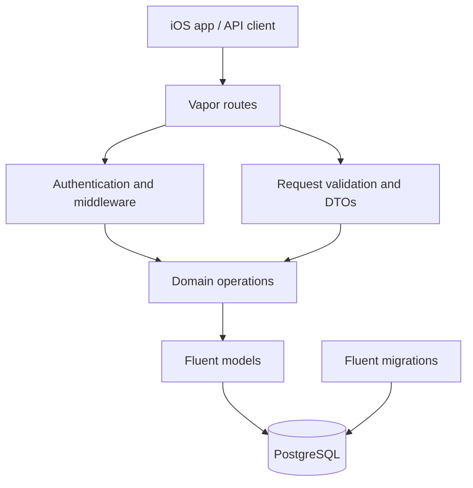

# Gymnastics Club — Backend

[](https://github.com/Rhaemira/GymnasticsClubBackend/actions/workflows/backend.yml)
[](#)
[](#)
[](#)

A Swift 6 / Vapor 4 REST API for the Gymnastics Club iOS application. PostgreSQL is the source of truth. Administrative management endpoints require a bearer token.

> **Project status:** Active engineering work. Check the current branch's CI results before treating a build or deployment as release-ready.

## Capabilities

- **Authentication** — administrator login, bcrypt password hashing, opaque bearer tokens, token revocation and expiry.
- **Authorization** — protected management, reporting, and analytics endpoints.
- **Club operations** — athletes, coaches, classes, enrollments, attendance, dashboard, reports, and analytics.
- **Data integrity** — additive migrations, attendance uniqueness, class-capacity bounds, enrollment-capacity enforcement, and transactional operations.
- **Operational readiness** — health endpoint, native scripts, Docker Compose, PostgreSQL persistence, and CI smoke tests.
- **Defensive validation** — normalized inputs, canonical athlete levels, and bounded login throttling.

## Architecture



| Area | Responsibility |
|---|---|
| `Auth/` | Login throttling and token utilities |
| `Middleware/` | Bearer-token authentication and security headers |
| `Commands/` | Administrative CLI commands |
| `DTOs/` | Request and response contracts |
| `Models/` | Fluent persistence models |
| `Migrations/` | Schema creation and additive integrity constraints |
| `Validation/` | Shared request validation |
| `routes.swift` | HTTP route registration and handlers |
| `configure.swift` | Database, middleware, migrations, and app configuration |
| `Scripts/` | Native setup, migration, startup, and admin creation |

## Requirements

- Swift 6.0 or newer (CI currently uses Swift 6.1)
- PostgreSQL 14+ for native development
- Docker Desktop with Docker Compose v2 for containerized development

## Quick start

### Option A — Docker Compose

```bash
cp .env.example .env
# Edit .env and set a unique local DATABASE_PASSWORD.
docker compose up --build -d
docker compose ps
curl --fail http://127.0.0.1:8080/health
```

Compose starts PostgreSQL, waits for readiness, applies migrations, and then starts the API. The database uses a named volume. Ordinary shutdown preserves database data:

```bash
docker compose down
```

**Do not use `docker compose down -v` on a database whose data you want to keep.** PostgreSQL is not published to the host by default; the API binds to localhost by default. Put the API behind a TLS-terminating reverse proxy for remote access.

### Option B — Native macOS

```bash
cp .env.example .env
# Edit .env with local PostgreSQL connection details and a unique password.
Scripts/setup.sh
```

Create the local role and database using names matching `.env`:

```bash
createuser -P gymnastics_dev
createdb -O gymnastics_dev gymnastics_club
```

Then migrate and start:

```bash
Scripts/migrate.sh
Scripts/start.sh
curl --fail http://127.0.0.1:8080/health
```

The startup script checks PostgreSQL readiness and port availability. By default, native startup binds to `0.0.0.0:8080` for trusted local-network development. Restrict access appropriately and use HTTPS for production.

## Create the first administrator

There is no public administrator-registration endpoint. Create the initial administrator using the interactive script:

```bash
Scripts/create-admin.sh
```

The password is prompted without echo. Passwords must contain at least 12 characters and no more than 72 UTF-8 bytes (the bcrypt input limit).

For automation or CI, the command supports environment-provided credentials; use temporary credentials and ensure logs are masked. Never reuse CI credentials in a real environment.

## Configuration

Copy `.env.example` to `.env`. The application requires database configuration at startup.

| Variable | Purpose |
|---|---|
| `DATABASE_HOST` | PostgreSQL hostname |
| `DATABASE_PORT` | PostgreSQL port |
| `DATABASE_NAME` | Database name |
| `DATABASE_USERNAME` | Database role |
| `DATABASE_PASSWORD` | Database password |
| `DATABASE_TLS` | `disable`, `prefer`, or `require` |
| `AUTH_TOKEN_TTL_SECONDS` | Token lifetime (900–86400 seconds) |
| `PORT` | HTTP port used by native startup |

For production, use a secret manager, a dedicated database role, strong unique credentials, and `DATABASE_TLS=require`. Never commit `.env` or place secrets in command history, screenshots, or logs. The Compose-only private-link TLS exception is scoped to its internal database service; do not use it for an external database.

## API overview

| Area | Routes | Access |
|---|---|---|
| Health | `GET /health` | Public |
| Service identity | `GET /` | Public |
| Authentication | `POST /auth/login` | Public |
| Current session | `GET /auth/me` | Bearer token |
| Logout / revoke | `POST /auth/logout` | Bearer token |
| Club management | `/athletes`, `/coaches`, `/classes`, `/enrollments`, `/attendance` | Bearer token |
| Insights | dashboard, reports, analytics routes | Bearer token |

See [API_CONTRACT.md](API_CONTRACT.md) for payload shapes and client integration details. The health endpoint reports database readiness; it is not a substitute for monitoring, alerting, or an authenticated application-level check.

## Security model and operational limits

- Passwords are stored with bcrypt; raw passwords are never stored.
- Login returns a random opaque token once. Only its SHA-256 digest is stored in PostgreSQL.
- Expired and revoked token digests are opportunistically cleaned during successful login.
- Login failures are throttled by remote address and normalized email using a bounded, pruned in-memory limiter.
- The current limiter is **per application instance**. It is not a distributed security boundary. Before horizontal scaling, deploy shared edge rate limiting and configure trusted-proxy address handling.
- Forwarded headers must be stripped from untrusted clients and set by the trusted reverse proxy.
- Server logging is intentionally capped at `info` to avoid emitting SQL bind parameters and sensitive diagnostics.

## Database and migration safety

Migrations are tracked by Fluent. Existing migration files are retained; schema evolution should use additive migrations. The historical `FixCascadeDeletes` migration is intentionally not registered because it drops and recreates populated tables. **Do not execute it.**

The attendance uniqueness migration does not silently delete historical duplicates. If duplicates are found, it aborts so they can be reviewed and resolved through an explicit, audited maintenance operation.

## Tests and CI

Run the integration suite against a dedicated disposable PostgreSQL database:

```bash
swift package resolve
swift build
swift test
```

Never point integration tests at production data. The GitHub Actions pipeline includes:

- Linux Swift build and PostgreSQL integration tests
- Native macOS migration, administrator creation, server startup, health, and authenticated API smoke tests
- Docker Compose startup, health/authenticated API checks, and database-volume persistence verification

A green CI run verifies the configured automated checks; it does not by itself certify a production deployment.

## Deployment checklist

- [ ] Configure HTTPS and a trusted reverse proxy.
- [ ] Strip untrusted forwarding headers and set trusted proxy metadata.
- [ ] Inject secrets from a secret manager; use a dedicated database role.
- [ ] Set `DATABASE_TLS=require` for external PostgreSQL.
- [ ] Restrict database network access.
- [ ] Run migrations as a controlled deployment step.
- [ ] Configure shared rate limiting before running multiple app instances.
- [ ] Monitor health, logs, database capacity, and authentication failures.
- [ ] Back up PostgreSQL and test restore procedures.

## Contributing

See [CONTRIBUTING.md](CONTRIBUTING.md). Report security issues privately according to [SECURITY.md](SECURITY.md).

## Related project

- [GymnasticsClubApp](https://github.com/Rhaemira/GymnasticsClubApp) — native SwiftUI iOS client.
