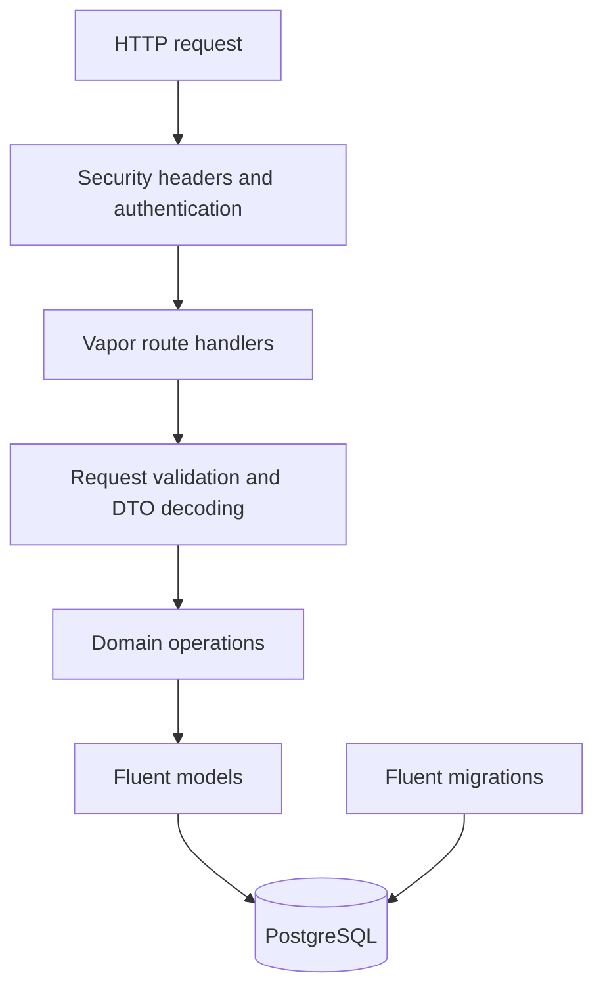

# Backend architecture

## Request lifecycle

## Responsibilities

- **Routes** expose the HTTP API and coordinate operations.
- **Middleware** applies security headers and authenticates bearer tokens.
- **DTOs** define explicit API request and response contracts.
- **Validation** centralizes input validation and normalization.
- **Models** represent persisted domain data through Fluent.
- **Migrations** evolve the schema and enforce data invariants.
- **Commands and Scripts** support administrator creation and repeatable local operations.

## Trust boundaries

The API is the authorization and validation boundary. The iOS client is untrusted. PostgreSQL constraints protect critical invariants even when requests race. Reverse-proxy forwarding metadata is trusted only when the deployment explicitly configures the proxy boundary.

## Migration policy

Prefer additive migrations. Do not modify a migration that may have run in an existing environment. A migration that discovers ambiguous historical data should stop and require an explicit audited remediation rather than silently deleting records.
